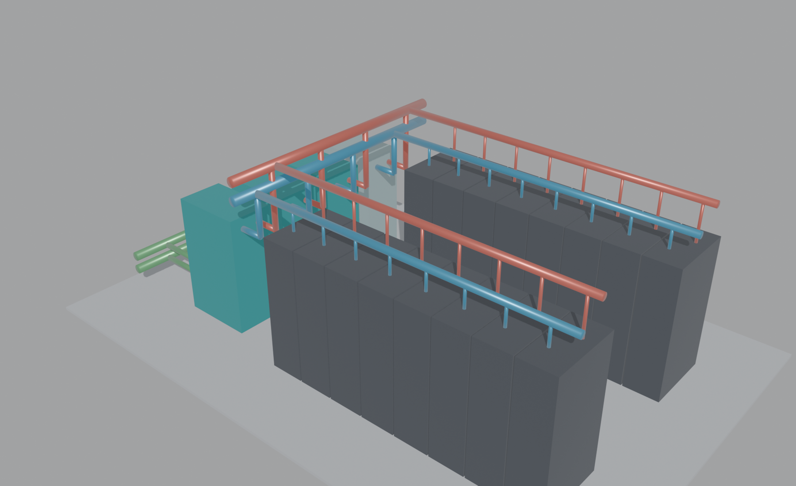

# OpenUSD 3D representation of the cooling system

`npm run twin:usd -- [design.json] [out.usda]` writes an OpenUSD scene of a checked cooling configuration. Without arguments it uses the configuration from the live run and writes `.private/twin/cooling-system.usda`.

## What the scene contains

- **Deterministic geometry:** every count and size comes from the design. There's no hand-modelled content, and the scene is never a second source of engineering numbers.
  - The racks, in rows facing a shared aisle.
  - The CDUs: duty units in teal, standby units lighter.
  - The secondary loop:
    - per-CDU risers and a distribution header;
    - a header per rack row and a supply drop and return drop per rack;
    - supply pipes in blue, return pipes in red.
  - Facility water to each CDU from a wall header, in green.
- **Pipe sizes:** inner diameters come from the flows at a 1.5 m/s design velocity, rounded up to 5 mm.
- **Engineering values:** stored as `nova:` attributes on the prims, for example `nova:flowLpm`, `nova:supplyC`, `nova:role` and `nova:capacityKw`. When the SysML model exists, `nova:sysmlElementId` links the parts to the CATIA Magic elements.
- **USD conventions:**
  - `metersPerUnit = 1`, `upAxis = "Z"`, `defaultPrim = "CoolingSystem"`, `kind = "assembly"`;
  - explicit polygon meshes with `UsdPreviewSurface` materials;
  - display colours as a fallback for simple viewers.
- **Status:** synthetic schematic geometry with illustrative lab values. This is *not* a SimReady-validated asset: no physics, no semantic schema, no vendor geometry.

## Checking and viewing

`blender -b --factory-startup --python scripts/twin/render_blender.py -- <in.usda> <out.png>` (absolute paths) imports the file and renders a preview. The import doubles as a validity check: all 89 prims of the example import. The file also opens in any OpenUSD viewer, for example USD Composer or usdview.

A note on implicit shapes: Blender 5.2 imports material bindings on explicit meshes but not on implicit `Cube`/`Cylinder` prims. The generator therefore writes meshes.

## Next steps

1. Generate the scene from the live run, using the checked design and the SysML element ids from the model receipt. It could become an ITEROP step with its own signed receipt, the same pattern as the system model.
2. Show it in the NOVA workspace's 3D canvas.
3. When licensed vendor assets are available, reference SimReady CDU and rack assets instead of boxes, and run the SimReady validator.
