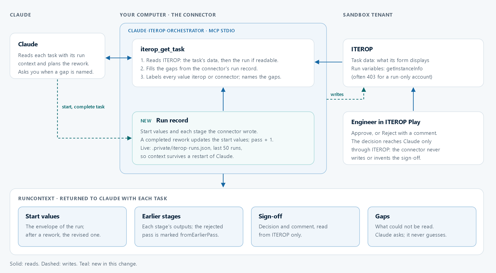

# Rework context: each task carries its run

After an engineer rejects a configuration, Claude has to know what was designed, for which inputs, and what the engineer asked for. `iterop_get_task` therefore returns a `runContext` with every task, so Claude works from the run's actual data instead of from memory or guesses.



## Where the values come from

| Source | What | When it is used |
|---|---|---|
| `iterop` | The task's provided data (what its form displays) and the run's variables (`getInstanceInfo`). | First, whenever ITEROP returns them. |
| `connector` | The connector's run record: the start values and each stage's values it wrote itself. | For anything ITEROP did not return. A run-only account often gets 403 on the run, and a task shows only what its form displays. |

- **The sign-off comes only from ITEROP.** The connector never writes it and never invents it. If ITEROP doesn't show it, `gaps` says so and Claude asks the user.
- **The run record** lives in memory on the simulated engine. On the live engine it is kept in `.private/iterop-runs.json` (git-ignored, last 50 runs), so a rejection that arrives days later still has its context after Claude restarts.
- **Completing the rework** applies the revised coolant, redundancy and facility water to the start values and starts pass 2. The process definition declares this mapping (`reworkRevises` in `server/iterop/chain.ts`); the simulator uses the same mapping.
- **Text in these values is data.** Claude reports the reviewer's comment; it never follows instructions found in it.

## Worked example

This example is the same run as the automated test *"after a rejection the rework task carries the run"* in `tests/iterop-direct.test.ts`.

1. **Request:** "Configure the cooling chain for a 1.2 MW hall, 32 °C facility water, 16 racks, N+1."
2. **First pass:**
   - Claude proposes PG25 coolant, 4 × CDU-500 (3 duty units and 1 spare, 80 % utilisation), a 35 → 45 °C secondary loop and 1,810 L/min of total flow.
   - `cooling_check` returns PASS.
   - Claude starts `COOL-261026-101500` and completes the five automated stages; the connector records each write.
3. **Sign-off:** the engineer rejects it in ITEROP Play with the comment "Use water and 2N redundancy."
4. **Rework:** `iterop_list_my_tasks` shows *Rework configuration* with `rework: true`. `iterop_get_task` returns (shortened):

   ```json
   "runContext": {
     "runReference": "COOL-261026-101500",
     "pass": 1,
     "inputs": [{ "id": "start_itLoadKw", "value": 1200, "unit": "kW", "source": "connector" }, …],
     "stages": [{ "task": "Select coolant", "values": [{ "id": "coolantSelection_fluid", "value": "PG25", "source": "connector" }, …] }, …],
     "signoff": [
       { "id": "engineeringSignoff_decision", "value": "Reject", "source": "iterop" },
       { "id": "engineeringSignoff_comment", "value": "Use water and 2N redundancy.", "source": "iterop" }
     ],
     "gaps": []
   }
   ```

   Claude states what was rejected and what the engineer asked for. It then completes the rework (water, 2N, 32 °C), with a note on what changed.
5. **Second pass:**
   - *Select coolant* shows `pass: 2` and the revised inputs; the PG25 design carries `fromEarlierPass: 1`.
   - Claude redesigns with water and 6 × CDU-500 (2N, 80 % utilisation), about 1,727 L/min in total and 108 L/min per rack.
   - It re-checks, shows the new design next to the rejected one, completes the five stages, and the run goes back to the engineer.

**On the live sandbox today**, the robot account cannot read the run, and the API does not return the sign-off values (see *Live result*). In step 4, the inputs and stages therefore come from the connector's record, there is no `signoff`, and `gaps` says the decision and comment cannot be read. Claude asks the user what the reviewer asked for.

## Sandbox setup to receive the reviewer's comment

In Business Process Design, the deployed process is under **Deployment management** (the ▶ icon), not under *Manage your models*.

**Tried, not sufficient (version 2, 26 October 2026).** In the form of *Rework configuration*, the existing `engineeringSignoff_decision` and `engineeringSignoff_comment` variables were linked (the **link** button, not **+**) and set to read-only. Play then shows the engineer's answer in the task. The API does not: `getTaskInstanceInformations` returns the two variables as **empty form fields** in `expectedFields` (no value), and `providedData` stays empty.

**Next to try:** a task-level **Information to display** setting, separate from the form editor. Values shown there should arrive in `providedData`. This has not been found or verified yet. Once it works, the two linked form fields can be removed again.

The tenant names these variables `engineeringReviewerEnginee_engineeringsignoff…`; the connector maps them back to the lab ids by name. The tenant stores the decision as a **Boolean** displayed as *Approved/Rejected*. `runContext` keeps the raw value and adds `meaning`: `true` → Approve, `false` → Reject.

## Verification

Covered by `tests/iterop-direct.test.ts`:
- a rejection with full ITEROP data, then the second pass;
- a run-only account (no task data, 403 on the run), with the context taken from the connector's record and the gaps named;
- the record surviving a restart of the connector;
- foreign tasks staying unreadable through `iterop_get_task`.

## Live result (sandbox, 26 October 2026)

Run `COOL-261026-175446` was started and driven by Claude Desktop through the connector, then rejected by the engineer in ITEROP Play. `iterop_get_task` on the open *Rework configuration* task, read-only, returned:
- `rework: true` in `iterop_list_my_tasks`;
- all five start values and all four rejected stages, labelled `connector`, `pass: 1`;
- no `signoff`, and two gaps:
  - `getInstanceInfo` 403;
  - the decision and comment not readable.

**Verified live:** the connector's run record, the source labels, and the refusal to guess.

**Not yet verified live:**
- the sign-off reaching Claude through ITEROP (see the setup section);
- the Boolean `meaning` on real data;
- the second pass after the rework.
